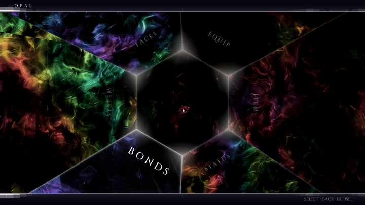
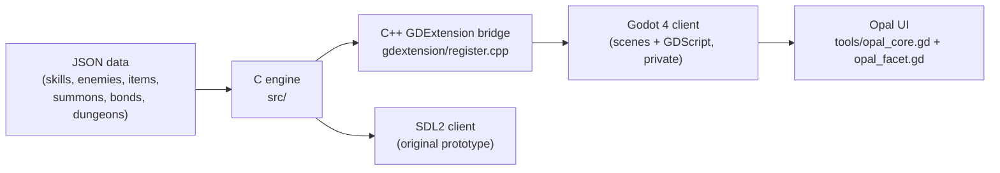

# OPAL engine

The engine behind **OPAL**, an original turn-based JRPG I'm building solo. The game logic is about 18,000 lines of C11 that know nothing about how the game is drawn. The same engine first ran an SDL2 client I wrote, and now runs inside Godot 4 through a C++ GDExtension bridge.

This repo holds the engine, the bridge, and the fluid simulation behind the game's UI. The game itself (story, scenes, art, music, and data files) is private.



## How it fits together



- **The engine never draws anything itself.** Godot calls into it through `OpalGame`, a class with 73 methods exposed to GDScript, and draws whatever state comes back.
- **One codebase, two builds.** A few modules still contain the original SDL2 drawing code. For the Godot build, `gdextension/sdl_compat.h` stubs out the SDL types behind the `OPAL_GDEXTENSION` define, so the same sources compile without SDL installed.
- **Content is data-driven.** Skills, enemies, items, equipment, summons, bonds, dialogue and dungeons load from JSON (`*_loader.c`). The few hard-coded scenes in `dialogue.c` and `dungeon_1.c`/`dungeon_2.c` are prototype test content.

## What's implemented

| System | Files | What it does |
|---|---|---|
| Combat | `combat.c`, `stats.c`, `skills.c` | Turn-based battles across 10 element types. Hitting a weakness knocks the enemy down and grants an extra turn; downing every enemy unlocks a team attack or a standoff. Extra turns can be handed off to an ally. |
| Summons | `summon.c` | The protagonist holds several summons and switches between them mid-battle; each has its own skills, affinities and stat modifiers. Includes a compendium and fusion. |
| Party | `party.c`, `characters.c` | Party stats, leveling and skill learning. |
| Bonds | `bond.c` | Relationships with other characters that rank up through scenes and unlock perks (shop discounts, bonus EXP, extra-turn chance). |
| Dialogue | `dialogue.c`, `dialogue_loader.c` | Branching conversations with choices, flag-gated nodes, and effects that set flags or award bond points. |
| World and time | `time_system.c`, `activities.c`, `social_stats.c` | An in-game calendar split into time slots, free-time activities, and social stats. |
| Dungeons | `dungeon.c`, `dungeon_builder.c`, `dungeon_db.c` | Multi-floor dungeons with safe rooms, an alert level, treasure, and a boss, built through a small builder API. |
| Inventory and shops | `inventory.c`, `items.c`, `equipment.c`, `shop.c` | Items, equipment slots and shops. |
| Story events and quests | `events.c`, `event_registry.c`, `quest.c`, `trigger.c` | Declarative story events and quest rewards. |
| Save/load | `save.c` | Saves and restores the full game state, including position inside a dungeon. |

## The opal UI

Every menu and dialogue panel in OPAL is drawn by a real-time Navier-Stokes fluid simulation rendered as a faceted gem (`tools/opal_core.gd`, `tools/opal_facet.gd`, about 3,400 lines of GDScript and shader code).

- **Solver.** A 256×144 grid. Each frame runs advect → splat → vorticity confinement → divergence → 16 Jacobi pressure iterations → gradient subtraction. The first version ran only 2 pressure iterations, which never converged, so every stir produced a ring pulsing outward from the cursor instead of fluid that curls.
- **Open boundaries.** The sim edge used to act as a wall: pressure reflected off it and fluid bounced off the panel edges. Pinning pressure to zero just inside the edge, and treating samples from outside the grid as empty, lets fluid leave instead of piling up.
- **The dye field.** I wanted the gem to move only where the player stirred it. Velocity can't do that: the pressure solve enforces zero divergence everywhere at once, so velocity is coupled across the whole grid. Dye injected at the cursor and carried by the flow marks where the fluid actually went, so the render masks by dye instead.
- **Baked wisps.** The curving fire filaments come from line integral convolution along a curl-noise flow, about 48 noise steps per pixel. That's too slow to run live, so it's baked once at startup into a texture, and each facet reads it three times at slightly different offsets for chromatic dispersion.

## Building

**Godot extension (Windows, MSVC)**

1. Clone godot-cpp next to `gdextension/`. The engine is checked against the `4.5` branch, which loads in Godot 4.5 and later (the game runs on 4.6):
   ```
   git clone -b 4.5 https://github.com/godotengine/godot-cpp
   ```
2. Install SCons (`pip install scons`), then build:
   ```
   cd gdextension
   python -m SCons platform=windows target=template_debug arch=x86_64
   ```
   The library is written to `godot/bin/`. The first build also compiles godot-cpp, which takes a while.

**Quick compile check (Linux / WSL)**
```bash
cd gdextension
for f in $(grep -o '"\.\./src/[^"]*"' SConstruct | tr -d '"'); do
  gcc -std=c11 -fsyntax-only -DOPAL_GDEXTENSION -I../src -I. "$f" || echo "FAILED: $f"
done
```

**SDL2 client.** `main.c`, `audio_sdl2.c`, `notify_sdl2.c`, `hud.c`, `title.c`, `camera.c`, `pause_menu.c`, `room.c` and `status_screen.c` belong to the original SDL2 prototype client (SDL2, SDL2_ttf, SDL2_mixer). Its sources still compile against the current engine, but the client isn't maintained; the Godot client is where development happens.

## Status

The engine systems above are implemented. I'm building the first location in the Godot client now. Combat and dungeon scenes aren't connected to the Godot client yet, so there is no public playable build.

## Tech

C11, C++17 (GDExtension), Godot 4, GDScript and Godot shaders, SCons, SDL2. Developed on Windows with WSL2.
